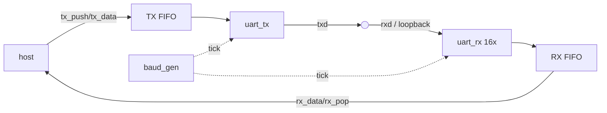

# P1.5: UART TX/RX with FIFOs (flagship 1)

> **Reference implementation, built with AI help.** This folder was written with an AI assistant (Claude) as a worked reference for my RTL/DV study plan. I am rebuilding it myself, step by step, and my own version will replace this one. It is not my solo work yet.

8N1/8E1/8O1 UART: baud tick generator, transmitter, 16x-oversampling receiver with a 2-flop
input synchronizer and mid-bit voting, framing and parity errors, and 16-deep TX/RX FIFOs.



## Verification plan
| Feature | Check |
|---|---|
| Data path | 10,000 random bytes in loopback, scoreboard queue |
| Parity / framing | injected bad parity and bad stop bit set `parity_err` / `frame_err` |
| Glitch rejection | a quarter-bit low pulse on rxd must not start a frame |
| Clock tolerance | TX and RX clocks off by +-2 %, +-4 %, +6 % (`tb_uart_ppm.v`) |
| FIFO full/empty | TX FIFO fills while the line is busy; nothing is lost |

## Run
```
make sim     # loopback + error injection
make ppm     # clock mismatch sweep
make synth   # Yosys
make lint
```

## Results
- 10,000 bytes, 0 errors; frame and parity errors flagged; glitch ignored.
- +-2 % and +-4 % PASS; +6 % fails, as expected for a 16x sampler (budget about +-4.5 %).
- About 1,000 cells, mostly the two 16 x 8 FIFOs.

## Bugs found while building
1. The FIFO accepted a push while full if a pop happened the same cycle; the testbench lost count of bytes. The contract is now `accepted = push && !full` (also changed in P1.4).
2. After a framing error the receiver took the still-low line as a new start bit. Added a WAIT_HI state.

See also: cocotb version of this test in `../p5.3-cocotb-uart`, gate-level simulation and SDC in `../p5.2-cdc-sta`.

## Not run here, and what is left for me
- Rebuild this myself from a blank file; my version replaces this one.
- Rebuild TX, then RX, then the top, running this testbench against each.
