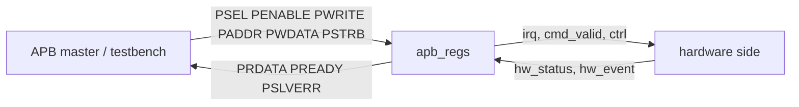

# P2.4: APB register block and verification plan (flagship 2)

> **Reference implementation, built with AI help.** This folder was written with an AI assistant (Claude) as a worked reference for my RTL/DV study plan. I am rebuilding it myself, step by step, and my own version will replace this one. It is not my solo work yet.

APB4 slave with 8 registers covering the access types real chips use: RW with byte strobes
(PSTRB), read-only status, W1C interrupt status where a new event wins over a clear, a write-only
command register that pulses `cmd_valid`, a constant VERSION, a partially implemented CONFIG,
PSLVERR for bad or unaligned addresses, and configurable wait states.



The full verification plan is in [docs/vplan.md](docs/vplan.md).

## Run
```
make sim       # random test, coverage lite (24 bins)
make sva       # bound APB protocol checker (Verilator)
make bugs      # BUG_W1C, BUG_STRB, BUG_SLVERR: each must FAIL
make regress   # bash regression: wait states 0-3 x seeds
python3 ../tools/regress.py regress.json --html dashboard.html
```

## Results
- PASS on all seeds, 24/24 coverage bins (100 %).
- Regression: 4 wait-state settings x seeds, all PASS.
- SVA checker passes on the clean bench and fires `a_stable_in_wait` on a bad master that moves the address during a wait state.
- All three seeded bugs FAIL as they should.
- `tb/apb_class_tb.sv` (class-based bench with an associative-array model and a covergroup) is written for EDA Playground and was not run here.

## Not run here, and what is left for me
- Rebuild this myself from a blank file; my version replaces this one.
- Write the vplan myself before looking at docs/vplan.md, then compare.
