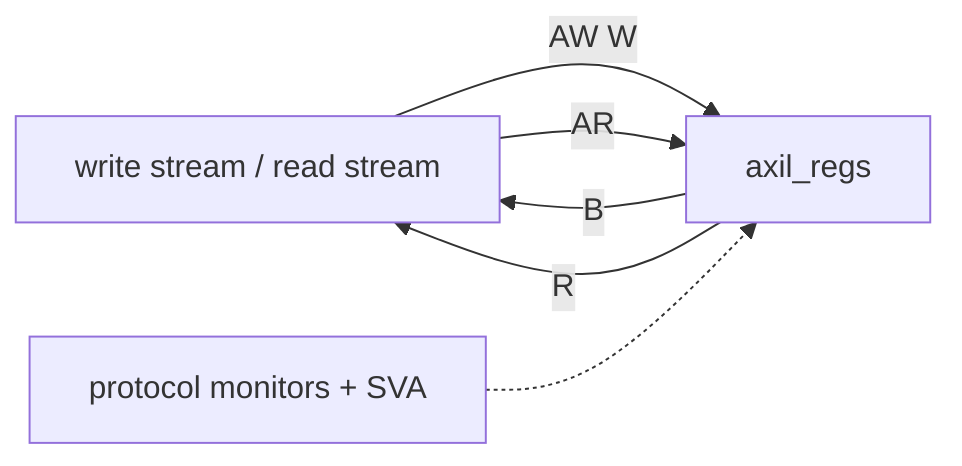
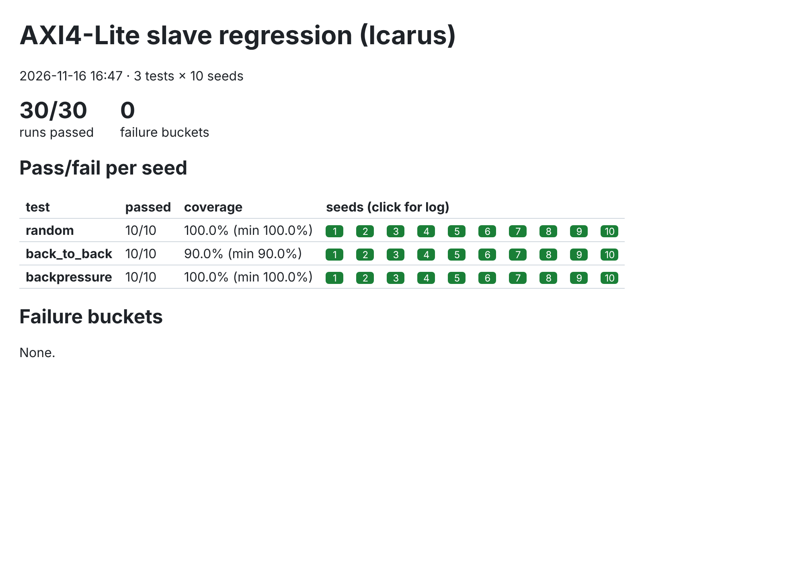
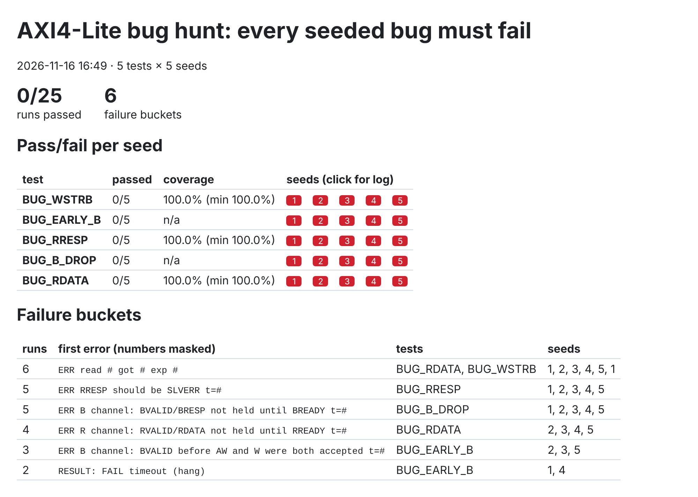

# P3.3: AXI4-Lite slave (flagship 3) + full AXI4 bursts

> **Reference implementation, built with AI help.** This folder was written with an AI assistant (Claude) as a worked reference for my RTL/DV study plan. I am rebuilding it myself, step by step, and my own version will replace this one. It is not my solo work yet.

AXI4-Lite slave with 16 x 32-bit registers: AW and W may arrive in any order, WSTRB byte lanes,
SLVERR for out-of-range addresses, independent read and write channels. The optional extension in
`axi4-bursts/` is a full AXI4 memory slave with FIXED / INCR / WRAP bursts.



## Verification plan
| Feature | Check |
|---|---|
| AW/W in any order, random delays | parallel write and read streams, AW-first / W-first / same-cycle bins |
| WSTRB | memory model merges byte lanes |
| Responses | BRESP/RRESP vs model (OKAY / SLVERR) |
| Back-pressure | random BREADY/RREADY low; payload must stay stable while VALID and !READY |
| Ordering | B only after both AW and W of that write (B-ordering monitor) |
| Protocol | `axil_sva.sv`: VALID held until READY, payload stable, no B before AW+W |

## Run
```
make sim                 # 3 modes: random / back-pressure / back-to-back
make sva                 # SVA checker (Verilator)
make bugs                # 5 seeded bugs, each must FAIL
make regress             # bash regression (also re-runs the bug hunt)
make dashboard           # Python regression + HTML dashboard
make -C axi4-bursts      # full AXI4 bursts
```

## Results
- PASS on all seeds in all 3 modes. Coverage 100 % in random and back-pressure modes; 90 % in back-to-back mode, where the AW-first / W-first bins cannot happen by construction (documented exclusion).
- Bug hunt 5/5: WSTRB ignored -> scoreboard; early BVALID -> B-ordering monitor on 3 of 5 seeds, timeout on the other 2; wrong RRESP -> response check; BVALID dropped -> `a_b_hold`; RDATA not held -> `a_r_hold`.
- AXI4 bursts: 5 seeds x about 600 bursts (about 5,000 beats) PASS; a mutant that treats WRAP as INCR fails with 722 errors. Not handled: 4 KB boundary, narrow transfers, interleaved outstanding bursts.
- `uvm/axil_uvm_pkg.sv` (agent, monitor, scoreboard, coverage, tests) is written but was not run here.





## Bugs found while building
- The early-BVALID bug was first only caught by a timeout. Added the B-ordering monitor; it now gives a clear message on 3 of 5 seeds, the other 2 still end in the timeout (open item: find out why the monitor misses them).

## Not run here, and what is left for me
- Rebuild this myself from a blank file; my version replaces this one.
- Optional step 3 (skid buffer on the channels) is not done; see the skid buffer in ../p5.5-interview-rtl for a start.
