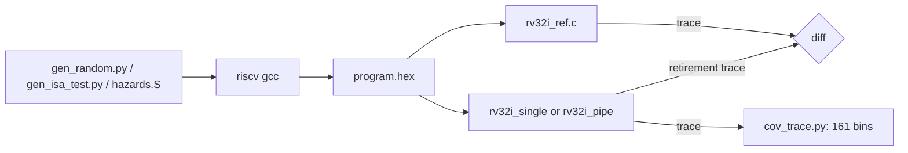

# P4: RV32I single-cycle and 5-stage pipelined cores (flagship 4, capstone)

> **Reference implementation, built with AI help.** This folder was written with an AI assistant (Claude) as a worked reference for my RTL/DV study plan. I am rebuilding it myself, step by step, and my own version will replace this one. It is not my solo work yet.

Two RV32I cores with the same ports, a C reference model, a directed ISA test, hazard tests,
constrained-random programs with coverage from the retirement trace, DPI-C lock-step,
assertions and two seeded pipeline bugs. Micro-architecture spec with cycle diagrams:
[docs/microarch.md](docs/microarch.md).



## Run
```
make isa         # 1,062-check ISA test on both cores, trace == C model
make hazards     # 10 hazard cases on the pipeline
make random      # 20 random programs x 2,000 instructions + coverage (SEEDS=500 for the big run)
make bugs        # BUG_FWD2 and BUG_NOSTALL
make dpi         # Verilator: C model in lock-step through DPI-C
make sva         # Verilator: assertions bound to the pipeline
make synth
```
Needs `riscv64-unknown-elf-gcc` (or any RISC-V gcc that takes `-march=rv32i -mabi=ilp32`).

## Results
- ISA test PASS on both cores; CPI 1.000 single-cycle, 1.297 pipelined (989 flushes, 0 stalls on this test).
- Hazards PASS: 2 stalls, 5 flushes, every result checked.
- Random: 500 programs, 1,128,302 retired instructions per core, 0 mismatches against the C model; coverage 161/161 bins = 100 %.
- DPI lock-step: 0 mismatches. SVA: PASS.
- `BUG_FWD2` caught by every test. `BUG_NOSTALL` passes the ISA test and is caught by hazard case 6 and the random programs: the directed test alone was not enough.
- Yosys: about 6,100 cells single-cycle vs 7,200 pipelined; longest gate path 41 vs 33 levels.

## Bugs found while building
- The register file's write-through bypass made a combinational loop in the single-cycle core (simulation hung). Fixed with a `BYPASS` parameter: 1 in the pipeline, 0 in the single-cycle core.
- The ISA test kept its case number in x3 (gp) while also using x3 for results; moved it to x28.
- The pipeline's TOHOST check fired before the store retired; now detected from the retirement port.
- DPI link error from C++ name mangling; fixed with `extern "C"`.
- Random programs stored registers that were never written (X on the core, 0 in the model); the generator now initialises x1-x30.

`uvm/core_uvm_pkg.sv` (UVM environment with the C model as predictor) is written but was not run here.

## Not run here, and what is left for me
- Rebuild this myself from a blank file; my version replaces this one.
- Rebuild the single-cycle core first, then the pipeline one hazard at a time, running `make isa hazards` after each step.
