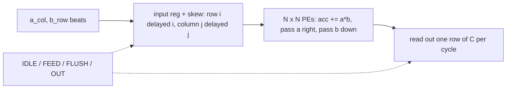

# P5.7: INT8 systolic-array matrix multiplier (stretch flagship)

> **Reference implementation, built with AI help.** This folder was written with an AI assistant (Claude) as a worked reference for my RTL/DV study plan. I am rebuilding it myself, step by step, and my own version will replace this one. It is not my solo work yet.

An output-stationary N x N systolic array: C[N x N] = A[N x K] x B[K x N] with signed INT8 inputs
and 32-bit accumulators. A enters from the left one row per PE row, B from the top, each skewed so
that A[i][k] and B[k][j] meet in PE(i,j) on the same cycle. Streaming interface with valid/ready
(bubbles allowed) and zero-gap back-to-back matrices. `PIPE_MUL=1` adds a product register in each PE.



**Cycle count** for one matrix: K beats + (2N-1+PIPE_MUL) flush + N read-out rows.

## Run
```
make trace   # NumPy model, 2x2, prints what every PE holds each cycle
make sim     # NumPy vectors -> RTL at N = 2, 4, 8, PIPE_MUL 0/1, with and without bubbles
make bug     # seeded skew bug: expected FAIL
make synth   # Yosys scaling table
```

## Results
- 12 configurations x 60 NumPy tests each PASS: all -128 x -128 (largest product), -128 x 127, 127 x 127, identity, K = 1 (outer product), K = 4N, K = 64 (accumulator grows to 2^20), and random K from 1 to 3N; matrices back to back with no gap; inputs driven to X between beats (nothing leaks); exact cycle count checked.
- The seeded skew bug (last row of A one cycle early) fails all 60 tests.

| N | PIPE_MUL | cells | flops | longest gate path |
|---|---|---|---|---|
| 2 | 0 | 3,371 | 216 | 40 |
| 2 | 1 | 3,484 | 280 | 25 |
| 4 | 0 | 13,244 | 873 | 40 |
| 4 | 1 | 13,672 | 1,129 | 25 |
| 8 | 0 | 52,453 | 3,530 | 40 |
| 8 | 1 | 54,249 | 4,554 | 25 |

Area grows with N^2 (one multiplier and accumulator per PE); the longest path does not grow with N,
because every PE talks only to its neighbours. Registering the product cuts the path from 40 to 25
gate levels for about 3 % more cells and one more cycle of latency.

## Not run here, and what is left for me
- Rebuild this myself from a blank file; my version replaces this one.
- Not run here: OpenSTA critical path with a real library, and OpenLane/LibreLane on Sky130 to a DRC/LVS-clean layout (both need tools and PDK on my laptop).
- Write the spec and the cycle-count formula myself before reading this one.
